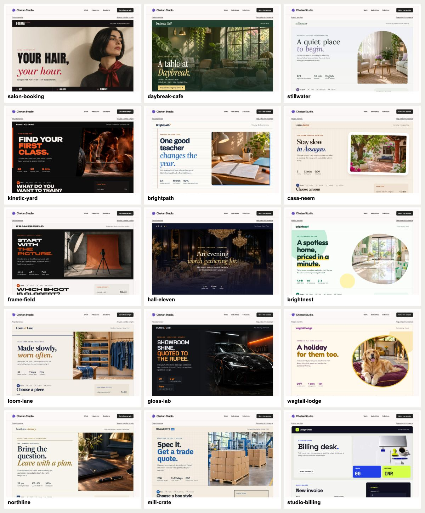

# From industry demos to individual business websites

## Decision for review

Keep the studio directory as the place to discover work. When an owner opens a demo from it, give them a website that feels like their business from the first tap. Let a hotel guest browse rooms, a photographer’s client open a series, and a wholesale buyer compare specifications. Each existing booking or enquiry flow can become the last part of that visit. Establish the direction on three structurally different sites before rolling it out to the rest.

## What the current build actually contains

Audit baseline **e7cb4b3**, 23 November 2026. I opened all 15 industry landing routes and all 15 linked demo routes in the local build at 1280 × 820 and 390 × 820. All 60 loads returned HTTP 200, mounted a heading and fit the viewport horizontally. I reviewed the first screens together and read the route, content and interaction code. These checks cover the landing state. End-to-end transactions and real-device Instagram testing belong in implementation QA. The catalog’s own check passed for all 15 industries, 20 projects and 12 kits. [Existing demo matrix](../studio/design-sources/DEMO-MATRIX.md) · [Catalog](../studio/site/catalog.js)

The screenshot in the brief shows the studio directory. Its repeated rows help visitors scan business types. The repetition that matters happens **after** selecting a demo. Kinetic Yard and Frame & Field open with a dark typographic pitch next to an image. Brightpath and Casa Neem pair a headline, a right-hand picture and a row of figures. Beneath many genuinely different photos, visitors encounter the same progress indicator, option cards, side summary and review screen. Twelve brands use a single renderer for that sequence. Their dates, capacities, prices and conditional choices already do substantial work. Preserve those rules. [Shared renderer](../studio/site/flow.js) · [Industry rules](../studio/site/kits.js)

Studio Forma, Daybreak and Ledger Desk have custom implementations. Daybreak is technically one demo route too, but browsing dishes, opening an item and asking about a table make it feel like a café. **Depth comes from meaningful destinations and actions.** Manakar is separate from the fictional Stillwater therapy demo. Its external practice website is already a useful client reference. Preserve both exceptions the owner identified. [Custom demos](../studio/site/demos.js) · [Manakar](https://www.manakar.in/)

The five external project links in the registry responded successfully. Manakar and Nukkad Naai are client examples. LaptopBuyGuide is catalog evidence, Velluto GT is an automotive concept, and Pocket Portfolio opens a GitHub template. Label their destinations accurately. The redesign work below applies to the portfolio-owned frontend demos. Existing external projects retain their own identity and deployment.

## Industry briefs

Paths below are proposed child routes of the existing demo slug. Each list describes a navigable destination that can open directly from a message, refresh and work with browser Back. Each brief ends with a task the finished frontend must pass.

### 1. Salons and barbers · Studio Forma · /demo/salon-booking

**Today.** The campaign photograph and service, stylist and time selection already work. A first-time visitor has little opportunity to choose a stylist based on their cuts.

**Build a lookbook-led salon.** Give the first screen an edge-to-edge haircut portrait and a compact stylist index. Use a fashion spread with tall crops, tight condensed headings and sparse service notes. Pages: Lookbook, Look detail, Stylists, Stylist profile, Service menu and Book. Prepare six sample looks with texture, length, technique, stylist, duration and service price. Each stylist page shows their own subset.

**Acceptance.** Open a short-hair look, inspect its stylist and tap “Book this cut.” The existing booking flow opens with the compatible service and stylist selected. Changing stylist updates availability. On a phone, returning to the lookbook restores its filter. The services-to-booking connection has a useful real-world reference. [Floyd’s Barbershop](https://www.floydsbarbershop.com/)

### 2. Cafés and restaurants · Daybreak · /demo/daybreak-cafe

**Today.** The existing café identity, menu categories, item details and group-table enquiry are the benchmark. Protect the current layout and interaction in this redesign.

**Optional extension after review.** Give Menu, Dish and Visit shareable destinations using the existing photography and type. The Visit page can hold opening hours, location and group dining. Preserve the current menu as the primary landing experience.

**Acceptance.** A café link opens a specific dish on a phone. Back returns to the same menu category. A group-table request produces a clearly marked sample acknowledgement. No visual rebuild is needed to establish the other brands.

### 3. Clinics and therapists · Stillwater · /demo/stillwater

**Today.** Stillwater opens directly into a support, session mode and time selector. Manakar separately shows what a credible practitioner introduction and service explanation look like.

**Build a practitioner-led practice.** Open on a short explanatory letter and portrait with a small contents navigation. Use quiet lavender, readable serif paragraphs, restrained imagery and generous line spacing. Pages: Meet the practitioner, Services, What to expect, Fees and availability, Request a first session. Write realistic illustrative service boundaries, session length and visit instructions. Clearly identify fictional staff details.

**Acceptance.** Someone can understand a first session, compare online and in-person options and request an example slot without entering personal health information. Use a fictional contact fixture. Keep Manakar as a clearly labeled external client case. [Manakar](https://www.manakar.in/)

### 4. Gyms and movement studios · Kinetic Yard · /demo/kinetic-yard

**Today.** The goal and level wizard leads to a trial class. A regular visitor first wants to know what is on this evening.

**Build a timetable-led club.** Open on today’s sessions in a bold black and orange departure-board layout. On mobile, use a horizontal day selector and vertical session list. Pages: Weekly timetable, Class format, Coach profile, First visit and Trial pass. Provide a fixture week with times, levels, instructors, capacity and equipment. Use training photography on the class and coach pages.

**Acceptance.** Filter to beginner evening classes, open a coach profile and claim a trial from that class. Full sessions show an alternative. Refreshing a class URL preserves its identity. Explain what a new member can expect before booking. [Barry’s](https://www.barrys.com/)

### 5. Tutors and learning centres · Brightpath · /demo/brightpath

**Today.** Subject, grade, lesson format and trial time exist as consecutive form steps.

**Build a curriculum explorer.** Use an illustrated ruled notebook with subject tabs and a chapter margin. Open with “What are you learning?” Pages: Subject library, Learning pathway, Sample lesson, Meet the tutor and Trial lesson. Write a short worked example and an accessible practice question for each launch subject. Show what changes between beginner and advanced levels.

**Acceptance.** A parent picks a grade, tries a question, reads the explanation, then opens a trial lesson with the correct subject and level already selected. Reset clears the exercise. Use fictional student details throughout.

### 6. Hotels and homestays · Casa Neem · /demo/casa-neem

**Today.** The room picker, dates, guest capacity, extras and nightly calculation already exist. Guests need a reason to prefer a room before quoting it.

**Build a small property guide.** Open with a courtyard photograph, an understated date bar and links to three rooms. Give each room its own gallery, sleeping arrangement, amenities, nightly rate and capacity. Pages: The house, Rooms, Room detail, Neighbourhood, Stay enquiry. Use warm paper, wide landscapes and hand-drawn local orientation. Put dates and guests in a compact bottom sheet on mobile.

**Acceptance.** Start from a family-room URL, enter dates and guests, compare another room for the same dates, then prepare an itemized stay request. Ineligible rooms explain their capacity. Preserve the date selection while browsing. [Ace Hotel](https://acehotel.com/)

### 7. Photographers and creatives · Frame & Field · /demo/frame-field

**Today.** A shoot-type form appears before the visitor has browsed a body of work. Its first screen resembles the fitness demo in composition.

**Build a photograph-first archive.** Start on a contact sheet with generous white borders and a narrow project index. Use the image captions as navigation. Pages: Archive, Series, Image viewer, Commission information and Brief. Curate three coherent sample series with distinct subjects, alt text and short credits. Let each series lead into its intended use and deliverables.

**Acceptance.** Open the third image of a series by URL, move using arrow keys or touch controls, close back to the same image, and request a similar shoot. Carry the series into the brief and preserve the existing usage and duration choices. [Magnum Photos](https://www.magnumphotos.com/)

### 8. Venues and event teams · Hall Eleven · /demo/hall-eleven

**Today.** The lighting and venue photography already differ from the other demos. Capacity and catering are hidden inside the estimate flow.

**Build a venue walkthrough.** Open on an annotated floor plan with an accessible list of spaces beside it. Use blue-black architectural lines, champagne accents and room photography that opens from the plan. Pages: Spaces, Space detail, Seating layouts, Menu packages, Plan a visit. Show seated and standing capacities directly on each space page.

**Acceptance.** Move from a room to theatre seating, enter the guest count and inspect the revised per-head estimate. If the number exceeds capacity, offer an eligible setup. Every space is selectable without using the drawing. [The Knot venue directory](https://www.theknot.com/marketplace/wedding-reception-venues)

### 9. Home services and trades · Brightnest · /demo/brightnest

**Today.** Home size, clean type, extras, frequency and slot already calculate an estimate. The first question assumes the visitor knows what each service includes.

**Build a service-area storefront.** Lead with a neighbourhood lookup and a clear service checklist. Use a white and mint service sheet with simple illustrations of tasks. Pages: Areas served, Service comparison, Deep clean detail, Visit estimator and Prepare for the visit. Define sample coverage areas, inclusions, exclusions and realistic time windows.

**Acceptance.** Enter an example covered area, compare standard and deep cleans, and carry the choice into the estimator. An uncovered area shows a useful next step. Removing an extra updates both duration and price.

### 10. Shops and boutiques · Loom & Lane · /demo/loom-lane

**Today.** Six photographed products exist. The first step treats buying a product like answering a questionnaire.

**Build a browsable collection.** Open on a merchandise wall with collection links, textile close-ups and visible prices. Use denim, oat and editorial display type. Pages: Collections, Product grid, Product detail, Size guide, Saved bag and Sample order summary. Populate variant-specific availability and materials. Give mobile shoppers a filter drawer and a clear return to results.

**Acceptance.** Deep-link to a product, choose an available size and colour, add two items, change quantity and inspect the updated bag total after refresh. An unavailable variant explains the next choice. Show a local sample receipt. Aesop’s category navigation is a useful reference for organizing a small catalog. [Aesop](https://www.aesop.com/)

### 11. Automotive businesses · Gloss Lab · /demo/gloss-lab

**Today.** Vehicle size, condition, packages, add-ons and drop-off slots are already modeled. The carbon-and-orange split hero feels close to Kinetic Yard.

**Build a detailing inspection bay.** Make a before/after vehicle viewer the opening interaction. Use graphite, cool metallic tones, diagnostic labels and comparable light angles. Pages: Transformation gallery, Job detail, Treatment comparison, Care guide, Build an estimate. Commission matched photo pairs of the same sample vehicle. A two-image toggle must work alongside any comparison slider.

**Acceptance.** Inspect a paint correction, compare it with ceramic protection, change the vehicle size and review its effect on time and price before choosing drop-off. Keep Velluto GT linked separately as a vehicle presentation concept.

### 12. Pet care and boarding · Wagtail Lodge · /demo/wagtail-lodge

**Today.** The suite, pet count, dates and preparation checks work. Visitors need to see where a pet sleeps and what a day there looks like.

**Build an illustrated lodge tour.** Start with a navigable property map and a text list of rooms. Use plum, sunny yellow, candid animal photography and rounded signs. Pages: Tour the lodge, Suite detail, A day at the lodge, Packing checklist and Plan a stay. Specify sample suite sizes, occupancy, daily routines and pickup windows.

**Acceptance.** Select a suite from the tour, add two pets and enter stay dates. If a suite is too small, show an appropriate option while keeping the dates. The packing checklist can be printed without pet or owner records. [Rover boarding](https://www.rover.com/dog-boarding/)

### 13. Consultants and advisers · Northline Advisory · /demo/northline

**Today.** The flow asks topic, urgency, document readiness and consultation length before demonstrating how the adviser thinks.

**Build an advisory publication.** Open on a featured decision memo and an index of business questions. Use navy headlines, generous margins, pull quotes and dated bylines. Pages: Insights, Sample memo, Practice areas, People and Prepare a consultation. Write three short fictional scenarios with assumptions and the questions a business owner should bring.

**Acceptance.** Open a memo, save two agenda items, then prepare a consultation brief prefilled with that topic. Print or copy the brief locally. Make document readiness a checklist, with no upload of private documents.

### 14. Manufacturers and wholesalers · Mill & Crate · /demo/mill-crate

**Today.** Box material, dimensions, print finish, minimum order and tiered prices already work. Procurement buyers need to compare products before requesting a quote.

**Build a specification catalog.** Open with a searchable SKU table and filter sidebar. Show dimension drawings, material samples and quantity breaks on the product page. Use industrial blue, neutral stock colours and monospaced dimensions. Pages: Product families, SKU detail, Compare, Specification sheet and RFQ basket.

**Acceptance.** Compare two packages side by side, add both to one RFQ, change quantity across a price break and print a correctly itemized sample request. Below-minimum quantities identify the affected item. On mobile, compare one attribute across two products at a time. [Protolabs](https://www.protolabs.com/)

### 15. Other businesses and billing · Finder and Ledger Desk

**Today.** “Other businesses” routes to a general finder with billing as its featured project. Ledger Desk already supports invoice composition, currency, totals and print. Billing is one possible need for an unclassified prospect.

**Build two appropriate entry experiences.** Keep the finder inside the portfolio. Ask what customers or staff need to do and link directly to a relevant existing demo. Present Ledger Desk as an application with an invoice register, invoice editor, customer details and print preview. Open on recent sample invoices and an outstanding-total summary. Use a compact ledger layout, numeric alignment and an app navigation rail.

**Acceptance.** An unclassified visitor who selects “Show my work” reaches a portfolio example. Someone selecting “Prepare an invoice” reaches Ledger Desk, edits a draft, reopens it from the register and prints the same total. Keep all customers and invoice data fictional.

## Implementation sequence after design review

1. **Prove the designs diverge.** Start with Studio Forma for the active salon outreach, Frame & Field for an image-led site, and Mill & Crate for a data-led site. Produce desktop and phone first screens plus one linked interior page for each. Review them side by side with brand names covered. A reviewer should be able to identify the business and the next action from the content and navigation.
2. **Deliver three complete journeys.** Finish look → stylist → appointment, series → image → commission brief, and SKU → compare → multi-item RFQ. Run their acceptance tasks on a direct link, on refresh and with browser Back. These are the first independently releasable packages.
3. **Ship the appointment and availability sites.** Kinetic Yard, Casa Neem, Hall Eleven, Brightnest and Wagtail Lodge each get their own discovery interface. Reuse the tested date, capacity and estimate functions underneath.
4. **Ship the remaining brands.** Brightpath, Loom & Lane, Gloss Lab, Northline and Stillwater, followed by the finder and Ledger Desk. Test Daybreak and the external Manakar link as reference journeys in every release.
5. **Update outreach destinations per completed brand.** Preserve existing DM URLs, replace the demo behind each stable root, and link directly to a meaningful interior page where useful. Refresh the project card and social preview using the working site’s real screen.

## Frontend implementation contract

- **Routing.** Extend the demo router to handle brand-owned nested paths. Supply a page title, share preview and descriptive heading per destination. Serve deep links directly. Unknown products and invalid routes get a helpful recovery link. Browser Back restores the previous list, filter or image.
- **Boundaries.** Keep the studio directory, evidence labels, sample CTA and a compact “Back to Chetan Studio” link. Within each demo the business owns its navigation, composition, typography, content hierarchy and mobile layout. Reuse pricing, date rules, field validation, dialog behavior and formatting. Each site owns its page components.
- **Content and assets.** Start with the photographs and originals already in the repo. Add images only where the page depends on them, such as matched detailing shots or multiple views of one room. Mark fictional claims, prices, staff and availability as sample data. Use the external sites as references for task design. Produce original copy, imagery and layouts.
- **Working frontend.** Use deterministic fixtures and browser state for demo bags, bookings, RFQs and invoices. Distinguish estimated, requested and confirmed states. Include empty, invalid, unavailable, edited and success states. Keep confirmations local. Production payments, real bookings, authentication and external submissions are outside these industry redesigns. The existing studio sample-request service is a separate feature.
- **Accessibility and verification.** At 390px and 1280px, run every brand’s named acceptance task. Check keyboard focus, touch targets, meaningful image text, reduced motion and readable pricing. Recheck long names, sold-out variants, full classes, invalid dates and minimum order edges. Print invoice and RFQ samples. Capture each new first screen and one result screen against the baseline image.
- **Review decision.** Approve the three pilot brands and their opening experiences first. If those examples still feel interchangeable, revisit the navigation and the visitor’s first decision before building the next batch.

## Implemented frontend

[Compare the redesigned first screens](redesigned-demo-overview.jpg) with the original overview above. Each redesigned business has its own navigation and direct interior URLs. The project finder lives in the studio directory. Daybreak retains its custom menu experience, and Manakar retains its original external client site.

The primary journeys include a salon lookbook with stylist handoff, a photographic series viewer with keyboard navigation, a multi-line wholesale RFQ, a weekly fitness timetable, room comparisons with stay dates, a venue floor selector, a service-area lookup, a boarding tour and printable checklist, interactive lessons, a practice letter and fee guide, a shop with a persistent session bag, a detailing inspection viewer, consultation memos with selectable agenda items, and a local invoice register. The detailing viewer explicitly labels the finish comparison as a lighting simulation.

Reference decisions came from business tasks visible on the original sites. Floyd’s connects a lookbook to salon services. Protolabs organizes manufacturing choices around services, materials and quoting. Ace Hotel exposes stay dates and guest counts. These patterns informed the information architecture. The portfolio uses original layouts and its existing sample photography. [Floyd’s](https://www.floydsbarbershop.com/) · [Protolabs](https://www.protolabs.com/) · [Ace Hotel](https://acehotel.com/)
